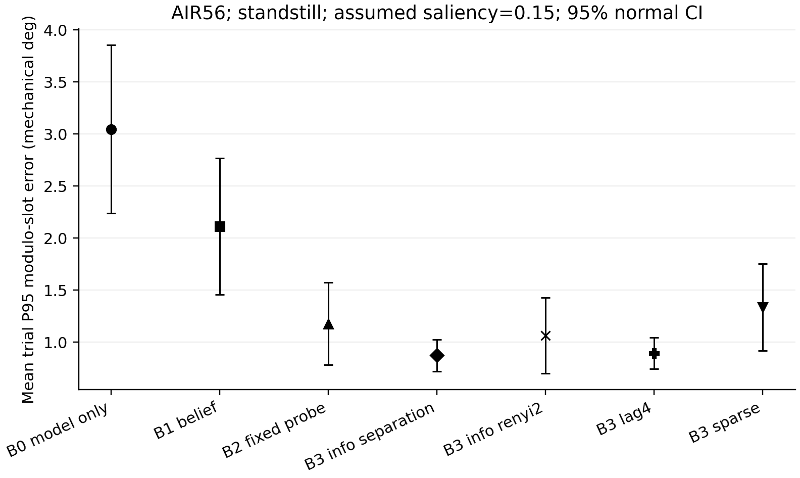
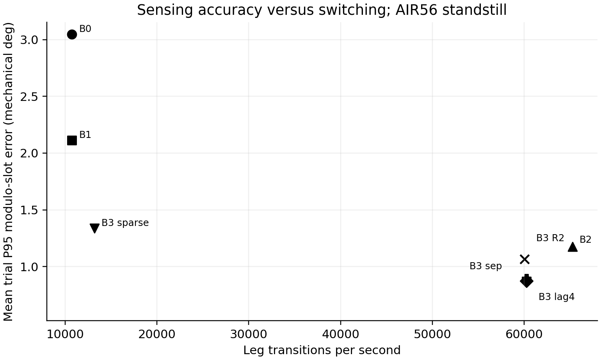
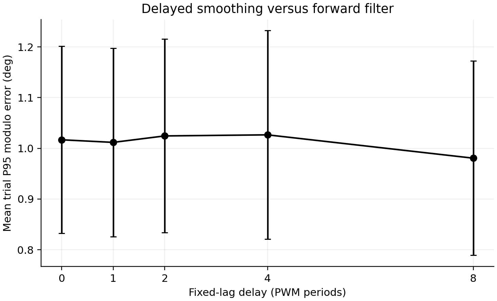

# Information-Optimal Coded PWM: host-only observability study

Issue: [#1](https://github.com/11lisov11/mic_theory/issues/1). Date: 2026-10-03.

## Verdict

**MODEL DOES NOT SUPPORT THE CLAIM** of bounded-error **absolute** mechanical rotor-position estimation. The repository's symmetric squirrel-cage `alpha-beta` model has no electrical dependence on absolute mechanical angle. The optional research extension tested here is periodic with an *assumed* 28th rotor harmonic, leaving 28 indistinguishable positions over one mechanical revolution. It supports at most a modulo-12.857-degree experiment. This is not an absolute virtual encoder and is not hardware evidence.

For the narrower modulo-period question, equal-budget information-seeking probes did **not** reach the issue's 30% P95-reduction criterion against fixed probes on untouched test seeds. An exploratory 20-seed/100-ms nonideal case showed a 10-13% paired improvement, but the 95% posterior sets covered only about 84-87% of truths; this was not a blind confirmatory result. Thus the term "bounded error" is not justified even for the synthetic modulo estimate over the tested duration. No firmware or high-voltage operation is implied by this study.

## Phase 0: observability before algorithms

In `models/induction_motor_alpha_beta.py`, stator/rotor flux, currents, torque and speed evolve from voltage, flux, current, speed and load. `theta_m` is updated as the integral of speed, but is absent from the electrical state equations and current/torque output functions. Consequently, for two states equal except `theta_m`, induction on simulation steps gives identical electrical trajectories for *any* common legal switching sequence. With identical measurement-noise distributions, the likelihoods are identical and the mutual information between absolute initial angle and electrical outputs is zero. No estimator can recover what this model does not encode.

`phase_zero_check` applies 80 identical legal vectors to paired plants whose initial angles differ by 1.23456789 rad. AIR56, AL31 and AO2 all produce a maximum electrical-output difference of exactly `0.0` in the deterministic host calculation. The numerical check confirms the code path; the structural argument establishes why a clever policy cannot repair this omission.

## Explicit research extension

`models/rotor_slot_saliency.py` defines a *separate, switchable, unvalidated* high-frequency differential-current sensing channel:

`delta_i = (tau * g / L_hf) [I + epsilon Q(N theta_m)] v + noise`,

where `Q(phi) = [[cos(phi), sin(phi)], [sin(phi), -cos(phi)]]`, `N=28` is an **assumed** harmonic, `epsilon` is tested at `0`, `0.05` and `0.15`, and `g` is a nuisance HF-gain term. The observer uses grid hypotheses for modulo angle, speed and gain (`0.8, 1.0, 1.2`); it receives commanded voltage, elapsed time and noisy current increments, **not** true angle, speed, flux or load. The actual speed is deliberately offset from the command by a hidden, seed-drawn +/-0.1% rated-speed term except in explicitly locked/standstill cases. Seed-specific disturbances are shared by every arm.

At `epsilon=0`, measurement predictions are independent of angle, the angle marginal remains uniform, and active probing cannot create information. For `epsilon>0`, `Q(N(theta+2*pi/N))=Q(N theta)` exactly. Therefore the extension can distinguish only angle modulo `2*pi/N`; its assumed period is `12.857` mechanical degrees. Neither the harmonic count nor its amplitude/noise ratio has been measured on AIR56, AL31 or AO2. The extension augments the measured switching-transient channel; it does **not** implement a coupled rotor-slot finite-element or saturation model of the machine.

## Fair PWM comparison

The existing `SensorlessAdaptiveFocBaselineController` supplies a common carrier in its **no-feedback** mode. Its normal host `measured_state` argument contains simulator flux and must not be used as a real sensorless baseline here. B0 is therefore an honest *model-only reference*, not a strong measured-current rotor-angle estimator. The meaningful position benchmark is B2, the fixed coded probe. This API limitation is material to the interpretation.

Each 100-us control interval applies a 10-us carrier vector and zero vector for the remaining interval. B2/B3 replace the final 10 us of zero vector with a 5-us active vector and its 5-us complementary vector. Their ideal average useful voltage is exactly the same (`0.1 * carrier voltage`) as B0/B1. There are six legal active probe choices. B3 uses either marginal-angle response separation or a pairwise Gaussian-overlap / Renyi-2 proxy, minus switching, current, torque-ripple and probe-energy penalties. The equal-budget B3 arms are required to select a probe whenever safe; `B3_sparse` may omit it and is reported as a Pareto point, not the main equal-budget comparison. The same `AIPwmSafetyGateway` screens sequences for minimum pulse, dead time, switching budget, current, voltage and no shoot-through. The accepted gate sequence drives the existing `AlphaBetaInductionMotorModel` and `TwoLevelInverterParams` plant. A 1/2/4/8-period backward smoother is evaluated separately at its corresponding latency.

The speed in most cases is a prescribed mechanical trajectory with a hidden offset. This isolates angle sensing but **does not validate closed-loop speed/torque control**. The `torque_step` sweep instead applies an equal load step to the free mechanical plant. In nonideal cases the physical inverter uses bus ripple, dead time, device drop, ADC quantization and sensing-aperture jitter while the estimator retains nominal commanded voltage. Parameter mismatch covers individual `Rs` (+/-30%, +60%), `Rr` (+/-30%, +60%), `Lm` (+/-20%), combined mismatch and within-run drift. These are synthetic stressors, not identified motor measurements.

## Reproducible evidence

The results below are from **final code with hidden speed offset**. Seed ranges `0-19`, `1000-1019` and `2000-2099` were seen during development and are **not** used as blind evidence. The algorithm was frozen before independent ranges `6000-6019` and `7000-7099`; no policy/tuning change followed inspection of those results. Source files, per-trial CSV, aggregate JSON and black-and-white SVG/PNG plots are in `experiments/info_optimal_coded_pwm/`.

| Suite | Seed range | Scope | Trials | Window | Interpretation |
| --- | ---: | --- | ---: | ---: | --- |
| `blind_smoke` | 6000-6019 | AIR56/AL31/AO2; 0, +1%, -1%; saliency 0/0.15; 7 arms | 2520 | 16 ms | untouched 20-seed smoke |
| `blind_focused` | 7000-7099 | AIR56/AL31, +1%, ideal nominal or nonideal combined mismatch; 7 arms | 2800 | 16 ms | untouched 100-seed paired comparison |
| `long_final` | 5000-5019 | AIR56/AL31, +1%, ideal or nonideal combined mismatch; B2 and two B3 scores | 240 | 100 ms | drift/coverage check |
| `lag_final` | 3000-3019 | AIR56/AL31, 0 and +1%, lags 0/1/2/4/8 | 480 | 16 ms | latency ablation |
| `stress_final` | 4000 | 3 motors, 12 motion modes, six saliency/nonideality/mismatch combinations | 1512 | 8 ms | **one-seed reconnaissance only**, not statistics |

The primary paired statistic is `(P95_fixed - P95_adaptive)/P95_fixed` computed **within each seed**, then averaged. The intervals below are percentile bootstrap 95% intervals across seeds. Mean P95 by arm is a different descriptive statistic and must not be substituted for the paired effect.

| Motor, +1% speed, 100 seeds | B3 separation vs B2: paired P95 change | 95% bootstrap interval | B3 95%-set coverage | Torque-ripple change vs B2 |
| --- | ---: | ---: | ---: | ---: |
| AIR56, ideal | -3.7% | [-12.5%, +4.5%] | 97.5% | +13.4% |
| AIR56, nonideal + combined mismatch | +2.1% | [-11.4%, +13.7%] | 94.3% | +11.0% |
| AL31, ideal | -11.6% | [-23.5%, -1.8%] | 96.2% | +11.7% |
| AL31, nonideal + combined mismatch | -0.1% | [-16.7%, +13.1%] | 95.6% | +17.8% |

The same 100-seed scenarios with the Renyi-2 score yielded paired effects of `-4.4%`, `+2.2%`, `-9.2%`, `-1.1%` in that order; all four 95% bootstrap intervals include zero. The 20-seed blind smoke across all three motors likewise fails the 30% criterion. At saliency zero, all methods have the same angle error and the angle posterior remains uninformative. The AL31 ideal cell's separation-score interval excludes zero **in the wrong direction**; no multiple-comparison-adjusted claim is made.

### Required ablation and cost example

AIR56 standstill, assumed saliency 0.15, **blind** 20 seeds, 16 ms. Values are means of per-trial metrics. The position error is **modulo 12.857 degrees**, never full mechanical angle. `B3_lag4` estimates the state four PWM periods in the past; its number is not a zero-latency result.

| Arm | P95 error, deg | Torque ripple RMS, Nm | Current RMS, A | Leg transitions/s | Extra probe copper energy, J/trial | Python compute, us/step | 95%-set coverage |
| --- | ---: | ---: | ---: | ---: | ---: | ---: | ---: |
| B0 model only | 3.047 | <1e-6 | 0.0530 | 10,750 | 0 | 3 | n/a |
| B1 belief, no probe | 2.114 | <1e-6 | 0.0530 | 10,750 | 0 | 167 | 96.7% |
| B2 fixed probe | 1.178 | 7.232e-5 | 0.0527 | 65,250 | 3.96e-7 | 290 | 96.9% |
| B3 separation, equal probe | 0.873 | 8.280e-5 | 0.0525 | 60,256 | 3.81e-7 | 1,002 | 99.1% |
| B3 Renyi-2, equal probe | 1.065 | 8.201e-5 | 0.0524 | 60,031 | 3.85e-7 | 1,200 | 98.9% |
| B3 separation + lag 4 | 0.895 | 8.280e-5 | 0.0525 | 60,256 | 3.81e-7 | 2,311 | 98.4% |
| B3 sparse | 1.336 | 2.410e-6 | 0.0525 | 13,188 | 2.2e-8 | 955 | 96.8% |

The sparse arm trades accuracy for far fewer switches. Equal-budget B3 and B2 have similar probe-copper energy; B3 can have **higher** torque-ripple RMS even while slightly reducing leg transitions. These are tiny current/torque operating points, not rated-load efficiency evidence. The copper proxy excludes iron, switching-transient, acoustic and EMC losses; therefore the issue's additional-loss <=1% criterion cannot be certified from it.

At 100 ms the 20-seed ideal paired gains are near zero. The nonideal cases have about 10-13% paired improvements in some cells, still below 30%; in those **nonideal** cells 95%-set coverage is only about 84-87% for adaptive arms and about 76-78% for B2. This directly rules out calibrated probabilistic bounds for those conditions. Lag 1/2/4/8 alters mean P95 by only a few hundredths of a degree within wide between-seed intervals while raising Python computation from about 1 ms (forward) to about 3.5 ms (lag 8) per **100-us** PWM interval. Neither is deployable on the target MCU in this form.

The one-seed broad sweep covers requested speed fractions 0, 0.1%, 0.5%, 1%, 2%, 5%, 10% and 50% plus reversal, ramp, startup, lock and load-step. It shows no gateway faults but severe loss of interval calibration in some medium-speed/nonideal cases (minimum observed coverage below 25%). With only one seed and an 8-ms window, no population-level speed-range claim is made. Full speed/current THD is `null`: the windows do not contain sufficient electrical cycles for a defensible harmonic estimate. Flux magnitude and current-ripple proxy are available in CSV, but no externally verified flux reference exists for a physical flux-error claim. Reacquisition time under long thermal drift is not established.

## Follow-up: speed-grid and process-uncertainty ablation

The original 100-ms runs exposed a numerical inference limitation: the seven-point low-speed grid represented `+1%` commanded speed near `1.45 rad/s` only with hypotheses at `1` and `5 rad/s`, while each seed also had an unobserved speed offset. A posterior that cannot represent the actual trajectory can become confidently wrong. This is a defect of the host observer approximation, not evidence that absolute rotor angle becomes observable.

An opt-in `dense` profile now uses a command-independent grid from `-3` to `+3 rad/s` in `0.25 rad/s` increments, plus four tail hypotheses, for low-speed commands. The opt-in `robust` profile adds a conservative nearest-neighbor Markov transition between adjacent speed and gain hypotheses (`0.001` probability per edge per 100-us step) and circular nearest-neighbor angle diffusion (`0.003` per side). These are declared simulation assumptions, not identified motor dynamics. The reverse-time smoother applies the exact adjoint transition. `legacy` remains the default, so the preceding numerical results remain reproducible. Neither new profile receives actual rotor speed or angle.

Development seeds `8000-8002` were used to choose between observation-noise multipliers `1.5` and `1.0`; the final `robust` profile uses `1.0`. On those three seeds, `dense` alone delivered most of the accuracy improvement, while diffusion improved nonideal B2 95%-set coverage from `92.3%` to `95.1%` for AIR56 and from `90.9%` to `95.2%` for AL31, at the cost of about `0.1` mechanical degree more set width. This three-seed ablation is exploratory. After freezing the profile, the untouched range `9000-9019` was evaluated for 100 ms per trial: two motors, ideal and nonideal combined mismatch, three probe arms, 240 matched trials per observer profile. The comparison script verifies identical case keys and exogenous-stimulus hashes before pairing.

| Held-out condition | B2 robust vs legacy: paired P95 reduction, bootstrap 95% CI | B3 separation robust vs legacy | Robust B2/B3 95%-set coverage | Robust B3 vs robust B2: paired P95 reduction, bootstrap 95% CI |
| --- | ---: | ---: | ---: | ---: |
| AIR56, ideal | 38.0% [33.4%, 42.1%] | 34.0% [27.9%, 39.9%] | 99.1% / 99.2% | -2.9% [-12.5%, 7.8%] |
| AIR56, nonideal + combined mismatch | 34.9% [28.5%, 41.3%] | 28.5% [17.7%, 37.2%] | 98.7% / 98.2% | -2.6% [-18.6%, 11.3%] |
| AL31, ideal | 39.1% [34.7%, 43.2%] | 34.5% [28.6%, 40.2%] | 99.1% / 99.3% | -10.0% [-24.4%, 2.2%] |
| AL31, nonideal + combined mismatch | 36.9% [30.2%, 43.1%] | 23.7% [16.4%, 31.4%] | 97.5% / 97.9% | -5.5% [-21.3%, 9.4%] |

Thus a better-resolved **modulo-angle observer** improved both fixed and adaptive probes. It did **not** establish an advantage for information-optimal probing: each robust B3-versus-B2 interval includes zero, and all point estimates favor B2. Robust credible sets are now conservative rather than under-covering (97-99% empirical coverage for nominal 95% sets), so they are still not calibrated 95% bounds. The extra state grid raises mean Python compute time for B2 from about `285` to `617 us`, and B3 separation from about `994` to `1617 us` per `100-us` PWM interval. These host implementations cannot run at the target control rate as written. No full-turn absolute-angle claim or hardware-readiness claim follows from this result.

A separate one-seed smoke run at zero, +1% and -1% commanded speed on AIR56, AL31 and AO2, with zero and 0.15 assumed saliency, completed 126 trials with no gateway rejections or nonfinite P95 errors. It is a software-regression check, not evidence of statistical accuracy across those operating points.

Reproduce the follow-up and matched comparison:

```powershell
python tools/run_info_optimal_coded_pwm_study.py --suite long --seeds 20 --steps 1000 --seed-offset 9000 --observer-profile legacy --out experiments/info_optimal_coded_pwm/legacy_matched_holdout
python tools/run_info_optimal_coded_pwm_study.py --suite long --seeds 20 --steps 1000 --seed-offset 9000 --observer-profile robust --out experiments/info_optimal_coded_pwm/robust_holdout
python tools/compare_coded_pwm_observers.py --legacy experiments/info_optimal_coded_pwm/legacy_matched_holdout/trials.csv --robust experiments/info_optimal_coded_pwm/robust_holdout/trials.csv --out experiments/info_optimal_coded_pwm/robust_holdout/comparison_vs_legacy.json
```

## Directional sensing hypothesis and a computational gain

The original synthetic saliency channel has an important symmetry. With known HF gain and isotropic alpha/beta Gaussian noise, the response differences between rotor-angle hypotheses have the same norm for all six equal-magnitude probe vectors. Separation, Renyi-2 overlap and local Fisher scores are therefore direction-independent; a test checks this numerically. Correlation between gain and angle creates small orientation differences, but does not supply an experimentally verified directional signature. This explains why local information scoring need not beat a fixed probe.

To test a falsifiable symmetry-breaking case, a separate *synthetic* experiment made beta-current measurement noise four times alpha-current noise while keeping the observer informed of that covariance. This is not a measured property of AIR56 or AL31. Three development seeds (`12000-12002`, 50 ms, standstill) selected `fixed_2` and `B3_info_fisher` on both motors. On untouched seeds `13000-13019`, the paired P95 reduction of Fisher-adaptive versus that selected fixed probe was `-14.1%` (bootstrap 95% interval `[-57.3%, +24.2%]`) for AIR56 and `-60.9%` (`[-157.8%, +10.5%]`) for AL31. Negative values denote worse adaptive performance; neither cell supports a gain. These are ratios of per-seed P95 values, not ratios of aggregated means. The fixed probe used about `0.65-0.68 ms` Python compute per 100-us period, versus `1.79-2.02 ms` for Fisher-adaptive.

The `B4_oracle_fisher` arm uses true simulated angle **only in evaluation** to maximize *local Fisher information* among the same legal probe sequences. It was also worse in mean P95 than `fixed_6` on those seeds. It is **not** an upper bound on P95 estimation performance: optimizing local Fisher information ignores the multimodal posterior and gain ambiguity. A direct expected-MAP-risk criterion (`B3_info_bayes_risk`) was tested on the three development seeds and did not improve mean P95 over the better fixed probe on either motor; even after exploiting the exact sign symmetry of opposite probe vectors it cost about `16-20 ms` per 100-us period. No holdout success claim is made for that criterion.

Inspection of the first held-out set suggested `fixed_6`, but that set then became development data for this *new* hypothesis. A fresh, untouched range `14000-14019` compared `fixed_6` with cyclic probing at noise ratios 1 and 4. At ratio 4 the paired relative P95 effects were `-19.7%` `[-48.9%, +8.7%]` on AIR56 and `-26.8%` `[-63.7%, +9.6%]` on AL31; thus even this simpler directional choice was not robustly better. At ratio 1 the corresponding effects were `+1.3%` and `-10.2%`, both with intervals spanning zero. A lower unpaired mean P95 in some cells must not be presented as a reliable per-seed gain. The data and checks are in `experiments/info_optimal_coded_pwm/anisotropic_holdout/`, `anisotropic_oracle_holdout/`, `fixed6_confirmatory_ratio1/`, `fixed6_confirmatory_ratio4/` and `fixed6_confirmation.json`.

One improvement **did** survive exact numerical checking: replacing the observer's per-speed `np.roll` loop with a vectorized angular transport. For the 4,176-state robust grid, a five-repeat, 500-call microbenchmark measured a median transport time of `295.6 us` before versus `115.0 us` after, a `2.57x` speedup, with elementwise agreement to `1e-15`. This is a host-computation gain, **not** a better angle estimator or evidence that the full controller fits the MCU's 100-us deadline; the overall Python trial still exceeds that deadline. The reproducible measurement is `experiments/info_optimal_coded_pwm/transport_benchmark.json`, generated by:

```powershell
python tools/benchmark_observer_transport.py --out experiments/info_optimal_coded_pwm/transport_benchmark.json
```

The directional-noise results strengthen the negative conclusion for the current information-optimal probe policy. Before another hardware-oriented PWM hypothesis, measure the actual rotor-angle-dependent HF response and current-channel noise covariance. A synthetic advantage created by an assumed sensor asymmetry would not establish a real induction-motor effect.







## Reproduce

Run from the repository root with the dependencies in `requirements.txt`:

```powershell
python -m pytest tests/test_info_optimal_coded_pwm.py -q -p no:cacheprovider
python tools/run_info_optimal_coded_pwm_study.py --suite smoke --seed-offset 6000 --out experiments/info_optimal_coded_pwm/blind_smoke
python tools/run_info_optimal_coded_pwm_study.py --suite focused --seed-offset 7000 --out experiments/info_optimal_coded_pwm/blind_focused
python tools/run_info_optimal_coded_pwm_study.py --suite lag --seed-offset 3000 --out experiments/info_optimal_coded_pwm/lag_final
python tools/run_info_optimal_coded_pwm_study.py --suite stress --seeds 1 --steps 80 --seed-offset 4000 --out experiments/info_optimal_coded_pwm/stress_final
python tools/run_info_optimal_coded_pwm_study.py --suite long --seed-offset 5000 --out experiments/info_optimal_coded_pwm/long_final
```

For figure-only regeneration, add `--plot-only --out <existing-result-directory>`. Trial noise and speed offsets are seed-derived; `stimulus_digest` in each CSV confirms common exogenous draws across arms. Wall-clock and Python per-step compute figures are machine-dependent. On the tested Windows/Python 3.12 host, the blind 20-seed smoke took about 337 s, blind focused 100-seed study about 429 s, and 100-ms study about 240 s. The machine-readable results and plots are generated by one runner; accepted historical Step27/Step28 artifacts are untouched.

## Limits and next hardware measurement

The plant is not a validated slot-harmonic machine. This study has no rotor-slot count, HF impedance map, ADC timing transfer function, saturation/temperature identification or measured sensor noise for the actual motors. The synthetic sensing response is not coupled back into the accepted low-frequency flux state; the host gateway verifies legal abstract switching but cannot certify the physical IPM. The control carrier is the existing adaptive FOC no-feedback fallback, not a tuned current-measured MRAS competitor. The angle-speed-gain grid does not jointly identify `Rs`, `Rr`, `Lm` and load; the broad scenario sweep has one seed per cell. The bootstrap intervals address seed variation only, not model-form uncertainty or multiple-comparison correction. This is not a novelty or hardware-success claim.

### What would have to be measured on real hardware next?

1. With an independent isolated angle reference and appropriate current measurement, map differential current response versus mechanical angle for several stationary rotor positions, probe axes, amplitudes and temperatures. Establish whether a repeatable slot harmonic exists at all and its true period/SNR; do not assume `N=28`.
2. Measure actual applied vector timing, dead time, voltage drop, ADC aperture/latency, current ripple, torque ripple, device temperature, extra loss and conducted/radiated noise under the intended probe budget. Refit the observation likelihood from training runs and reserve independent validation runs.
3. Re-run the fixed versus adaptive comparison with a genuinely current-only tuned sensorless baseline, realistic closed-loop speed/torque dynamics, calibrated credible sets and held-out motors/loads. A measured modulo-only channel cannot resolve the absolute mechanical-angle ambiguity without an additional independent reference or a nonperiodic physical signature.
